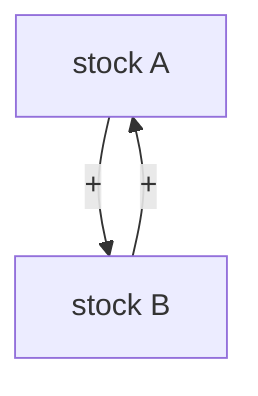
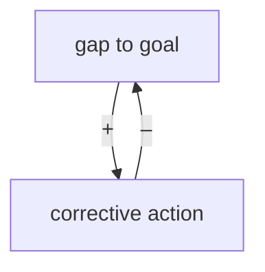
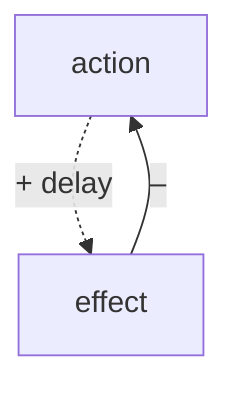
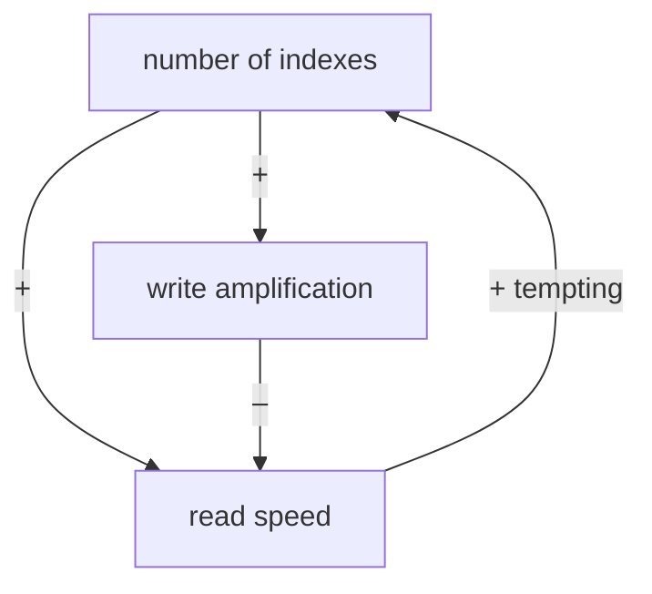

# systems-mapper Skill Implementation Plan

> **For agentic workers:** REQUIRED SUB-SKILL: Use superpowers:subagent-driven-development (recommended) or superpowers:executing-plans to implement this plan task-by-task. Steps use checkbox (`- [ ]`) syntax for tracking.

**Goal:** Build a domain-agnostic `systems-mapper` skill in the tris-brain plugin that maps any topic or system into a systems-thinking representation (two modes: Understand / Intervene).

**Architecture:** A lean `SKILL.md` router + 5 `references/` files (progressive disclosure), matching the existing `architecture-journal` skill pattern. Skills are auto-discovered from `skills/`, so no manifest registration is needed — only a plugin version bump. This is a **content-authoring** deliverable: "tests" are structural verifications (frontmatter/JSON parse, required-section greps, Mermaid sanity) plus one end-to-end acceptance run on a non-software topic.

**Tech Stack:** Markdown, YAML frontmatter, JSON, Mermaid, bash (`grep`/`jq`/`python3`), git.

**Source of truth:** `docs/superpowers/specs/2026-06-12-systems-mapper-design.md`. Where this plan embeds content verbatim, use it exactly; where it gives an authoring spec + canonical list, produce that content faithfully.

**Working directory:** all paths are relative to `/home/tringuyen/Developer/tris-brain`.

**GateGuard note:** a `pre:bash:gateguard-fact-force` / `pre:edit-write` hook requires stating (1) the request and (2) what the command/file produces, before the first Bash command and before creating new files. Do that once at the start of execution.

---

## File Structure

| File | Responsibility |
|---|---|
| `skills/systems-mapper/SKILL.md` | Router: mode/tier detection, the 6-step engine, pull-triggers, output workflow, guardrails, vault-save format |
| `skills/systems-mapper/references/leverage-points.md` | Meadows' 12 leverage points, ranked, generic + cross-domain examples |
| `skills/systems-mapper/references/archetypes.md` | 5 systems archetypes: structure, symptom, example, leverage |
| `skills/systems-mapper/references/cld-patterns.md` | Copy-paste Mermaid recipes for loops/stocks/delays |
| `skills/systems-mapper/references/templates.md` | Understand + Intervene output templates; vault-note frontmatter |
| `skills/systems-mapper/references/examples.md` | 3 worked maps from different domains (anti-anchoring) |
| `.claude-plugin/plugin.json` | version `1.1.0 → 1.2.0` |
| `.claude-plugin/marketplace.json` | version `1.1.0 → 1.2.0` |
| `README.md` | add `systems-mapper` to the skills list |

---

## Task 1: Scaffold skill + SKILL.md frontmatter

**Files:**
- Create: `skills/systems-mapper/SKILL.md`
- Create: `skills/systems-mapper/references/` (directory)

- [ ] **Step 1: Create the references directory and write SKILL.md frontmatter + skeleton**

Create `skills/systems-mapper/SKILL.md` starting with exactly this frontmatter, then the body skeleton headers (body filled in Task 2):

```markdown
---
name: systems-mapper
version: 1.0.0
description: "Map and transform any topic or system into systems thinking — stocks, flows, feedback loops, leverage points, and the iceberg model. Two modes: Understand (build a structural mental model of a subject to master it) and Intervene (map a real owned system to find leverage points and act). Use when the user says 'map this to systems thinking', 'what are the feedback loops in X', 'find the leverage points', 'systems map of …', 'draw a causal loop diagram', 'where's the leverage to fix …', 'help me understand X structurally', or wants to reason about any topic as an interconnected system. Domain-agnostic — never assume software."
---

# Systems Mapper — Map Any Topic Into Systems Thinking

> **Core philosophy: structure drives behaviour.** Find the stocks, the loops, and the leverage — then act or learn.

> **This engine is domain-agnostic. Do NOT assume software. Map the system the user actually named** — a market, a team, an ecosystem, a habit, a codebase: same engine.

## Modes
## Step 0 — Detect mode + tier
## The mapping engine
## Reference pull-triggers
## Output workflow
## Tiered knowledge
## Guardrails
## Vault save format
```

- [ ] **Step 2: Verify frontmatter parses and has the required keys**

Run:
```bash
python3 -c "import yaml; d=yaml.safe_load(open('skills/systems-mapper/SKILL.md').read().split('---')[1]); assert set(['name','version','description']) <= set(d), d.keys(); assert d['name']=='systems-mapper' and d['version']=='1.0.0'; print('frontmatter OK')"
```
Expected: `frontmatter OK`

- [ ] **Step 3: Commit**

```bash
git add skills/systems-mapper/SKILL.md
git commit -m "feat(systems-mapper): scaffold skill + frontmatter"
```

---

## Task 2: SKILL.md body — modes, engine, workflow, guardrails

**Files:**
- Modify: `skills/systems-mapper/SKILL.md` (replace the skeleton headers from Task 1 with full sections below)

- [ ] **Step 1: Write the full body**

Replace everything after the frontmatter with this exact content:

````markdown
# Systems Mapper — Map Any Topic Into Systems Thinking

> **Core philosophy: structure drives behaviour.** Find the stocks, the loops, and the leverage — then act or learn.

> **This engine is domain-agnostic. Do NOT assume software. Map the system the user actually named** — a market, a team, an ecosystem, a habit, a codebase: same engine.

## Modes

Both modes run the **same mapping engine**. Only the closing **tail** differs:
- **Understand** — build a structural mental model of a subject to master it. Tail = comprehension hooks.
- **Intervene** — map a real, owned system/problem to find leverage and act. Tail = ranked actions.

## Step 0 — Detect mode + tier (always first)

Print one line before any work, e.g.:
`Mode: Understand (concept, no owned instance) · Tier: fast`

**Mode rule.** Default = **Understand**. Switch to **Intervene** only when *both* an owned concrete instance **and** a change-signal are present.

| Signal | → Understand | → Intervene |
|---|---|---|
| Object | a subject/concept ("indexing", "Raft", "inflation") | a specific instance the user owns ("*my* pipeline", "*our* checkout") |
| Verb | understand, learn, master, study, explain | fix, debug, optimise, reduce, unblock |
| Symptom | none | pain present: slow, flaky, broken, "keeps happening" |
| Goal | comprehension / retention | action / change |

1. **Explicit override wins** (`mode=understand|intervene`, or "treat this as a learning exercise").
2. Else **Intervene** iff `(owned concrete instance) AND (symptom OR change-verb)`. Otherwise **Understand**.
3. **Ambiguous/mixed** → pick the more likely, **state the pick + one-line reason, and offer to flip**. Never switch silently on a genuine 50/50.

**Tier.** Default = **fast** (vault + model knowledge, no web). If the user passes `--deep`, run the `deep-research` skill to research + verify before mapping, and cite sources.

## The mapping engine (run for every map)

1. **Frame** — what system are we drawing? State the boundary + purpose, *deduced from behaviour, not rhetoric*.
2. **Stocks & flows** — the accumulations and the rates that change them.
3. **Feedback loops** — name each reinforcing (R) and balancing (B) loop, then render a **Mermaid causal-loop diagram** (see `references/cld-patterns.md`).
4. **Delays & nonlinearity** — where lag causes overshoot/oscillation; thresholds/cliffs.
5. **Leverage points** — rank weak → strong using `references/leverage-points.md`. Call out where effort is usually wasted (weak points) vs. where the real leverage is.
6. **Iceberg** — event → pattern → structure → mental model.
7. **Tail** — Understand or Intervene (see `references/templates.md`).

If a recurring pattern matches a known archetype, name it from `references/archetypes.md`.

## Reference pull-triggers

- Ranking leverage points (engine step 5, **either mode**) → read `references/leverage-points.md`.
- A recurring pattern smells like an archetype → read `references/archetypes.md`.
- Rendering the diagram → read `references/cld-patterns.md`.
- Producing the final output → read `references/templates.md`.
- Unsure how the engine generalises off-software → read `references/examples.md`.

## Output workflow

1. Print the Mode + Tier line.
2. (`--deep` only) run research.
3. Run the engine → **render the full map inline** (all 6 sections + Mermaid CLD).
4. Ask: **"Anything to change?"** Iterate in chat. **Never auto-save.**
5. On approval, offer to persist a vault note (see *Vault save format*).

## Tiered knowledge

- **fast (default):** `obsidian vault="tri-obsidian" search` / `read` for related notes, plus model knowledge. Mark anything reconstructed from memory as uncertain.
- **--deep:** invoke the `deep-research` skill; map from verified, cited findings.

## Guardrails

- **Anti-anchoring:** never assume software; map the named system. The 3 examples in `references/examples.md` are deliberately cross-domain.
- **Anti-overclaim:** systems thinking explains *complexity & leverage*, **not** memory/retention. Do **not** sell it as a learning hack. Do **not** assert: (a) that system-dynamics "generic structures" give universal cross-domain transfer; (b) that it boosts retention *and* covers material faster. Both were refuted (research 2026-06-12).
- **Anti-procrastination (Understand mode):** end by pointing back to retrieval + real application — "the map is the 20%, not the work."
- **Uncertainty honesty:** in fast tier, flag reconstructed claims; recommend `--deep` when stakes are high.

## Vault save format

On approval, write to the tri-obsidian vault via the `obsidian` CLI:

```bash
obsidian vault="tri-obsidian" create name="<topic> — systems map" silent
```
Then set frontmatter and body: `tags: [systems-thinking]`, `topics:` (wikilinks), `via: "[[systems-mapper]]"`, a backlink to `[[Systems thinking]]`, and the rendered map. Link related stubs (`[[Retrieval practice]]`, `[[Spaced repetition]]`, etc.) where relevant so each map compounds into the `[[Systems thinking]]` hub.
````

- [ ] **Step 2: Verify all required sections exist**

Run:
```bash
for h in "## Modes" "## Step 0" "## The mapping engine" "## Reference pull-triggers" "## Output workflow" "## Tiered knowledge" "## Guardrails" "## Vault save format"; do grep -qF "$h" skills/systems-mapper/SKILL.md && echo "OK: $h" || { echo "MISSING: $h"; exit 1; }; done
```
Expected: 8 `OK:` lines.

- [ ] **Step 3: Verify the anti-anchoring + anti-overclaim guardrails are present**

Run:
```bash
grep -qi "domain-agnostic" skills/systems-mapper/SKILL.md && grep -qiE "do not assume software|never assume software" skills/systems-mapper/SKILL.md && grep -qiE "not.*retention" skills/systems-mapper/SKILL.md && echo "guardrails OK"
```
Expected: `guardrails OK`

- [ ] **Step 4: Commit**

```bash
git add skills/systems-mapper/SKILL.md
git commit -m "feat(systems-mapper): mode rules, engine, workflow, guardrails"
```

---

## Task 3: references/leverage-points.md

**Files:**
- Create: `skills/systems-mapper/references/leverage-points.md`

- [ ] **Step 1: Write the file**

Content = Donella Meadows' 12 leverage points, **in increasing order of effectiveness (12 → 1)**. Each entry: the canonical name, a one-line domain-neutral definition, and one cross-domain example. Open with the key insight, then the list. Use exactly these 12 names and order:

```markdown
# Leverage Points (Meadows, weak → strong)

> Key insight: the places people **push hardest** (parameters, numbers) are the **weakest** leverage. The strong leverage (goals, paradigms) faces the most resistance. Rank every map's interventions against this ladder.

12. **Constants, parameters, numbers** — tax rates, buffer thresholds, a config value. (Ex: raising a connection limit; changing an interest rate.)
11. **Buffer sizes** — the size of stabilising stocks relative to flows. (Ex: cash reserves; a reservoir.)
10. **Stock-and-flow structures** — physical layout and pathways. (Ex: road network; DB schema.)
9.  **Delays** — the lengths of feedback delays relative to change. (Ex: shipping lead time; stats staleness.)
8.  **Balancing feedback loops** — strength of self-correcting loops. (Ex: a thermostat; price signals.)
7.  **Reinforcing feedback loops** — strength of self-amplifying loops; usually slow these down. (Ex: viral growth; compounding bloat.)
6.  **Information flows** — who has access to what information. (Ex: making a hidden cost visible.)
5.  **Rules** — incentives, constraints, punishments. (Ex: laws; API contracts.)
4.  **Self-organization** — power to add/change/evolve system structure. (Ex: letting teams form their own process.)
3.  **Goals** — the purpose of the system. (Ex: "growth" vs "resilience".)
2.  **Paradigms** — the shared mindset the system arises from. (Ex: "land can be owned".)
1.  **Power to transcend paradigms** — staying unattached to any single worldview.
```

Expand each line with 1–2 sentences of generic explanation. Keep examples drawn from **at least two non-software domains** across the file.

- [ ] **Step 2: Verify all 12 points present in order**

Run:
```bash
grep -cE "^(12|11|10|[1-9])\. " skills/systems-mapper/references/leverage-points.md
```
Expected: `12`

- [ ] **Step 3: Commit**

```bash
git add skills/systems-mapper/references/leverage-points.md
git commit -m "feat(systems-mapper): leverage-points reference"
```

---

## Task 4: references/archetypes.md

**Files:**
- Create: `skills/systems-mapper/references/archetypes.md`

- [ ] **Step 1: Write the file**

Five archetypes. For **each**, four labelled parts: **Structure** (which R/B loops + delay), **Symptom** (how it shows up), **Example** (cross-domain), **Leverage** (where to intervene). Use exactly these headings:

```markdown
# Systems Archetypes

## Limits to Growth
**Structure:** a reinforcing growth loop + a balancing loop that strengthens as a limit nears.
**Symptom:** growth that accelerates then stalls.
**Example:** a startup's referral growth hitting market saturation.
**Leverage:** don't push growth harder — address the limiting stock early.

## Shifting the Burden
**Structure:** a symptomatic quick-fix balancing loop that weakens the fundamental-fix loop (+ addiction side-effect).
**Symptom:** the quick fix works short-term; the real problem worsens; dependence grows.
**Example:** painkillers vs. treating the cause; hotfixes vs. root-cause fixes.
**Leverage:** invest in the fundamental fix; wean off the symptomatic one.

## Tragedy of the Commons
**Structure:** individual reinforcing loops draining a shared, delayed-feedback resource.
**Symptom:** rational individual use collapses a shared resource.
**Example:** overfishing; a shared CI runner everyone overuses.
**Leverage:** make the shared cost visible/felt; regulate access (rules, layer 5).

## Fixes that Fail
**Structure:** a fix that solves the symptom but triggers a delayed reinforcing loop that brings it back worse.
**Symptom:** the same problem recurs, larger, after each fix.
**Example:** adding indexes for every slow query → write amplification → more slowness.
**Leverage:** account for the delayed consequence; prefer fundamental fixes.

## Success to the Successful
**Structure:** two reinforcing loops competing for a shared finite resource; early winner gets more.
**Symptom:** winners win more, losers starve, regardless of merit.
**Example:** the team given the best projects keeps looking best.
**Leverage:** balance resource allocation; break the coupling.
```

Expand each with 1–2 sentences. Keep examples cross-domain (not all software).

- [ ] **Step 2: Verify all 5 archetypes with all 4 parts**

Run:
```bash
test "$(grep -cE '^## ' skills/systems-mapper/references/archetypes.md)" = "5" && test "$(grep -cE '^\*\*(Structure|Symptom|Example|Leverage):\*\*' skills/systems-mapper/references/archetypes.md)" = "20" && echo "archetypes OK"
```
Expected: `archetypes OK`

- [ ] **Step 3: Commit**

```bash
git add skills/systems-mapper/references/archetypes.md
git commit -m "feat(systems-mapper): archetypes reference"
```

---

## Task 5: references/cld-patterns.md

**Files:**
- Create: `skills/systems-mapper/references/cld-patterns.md`

- [ ] **Step 1: Write the file**

Copy-paste Mermaid recipes + the convention. Use exactly these fenced mermaid blocks:

````markdown
# Causal-Loop Diagram (CLD) Patterns — Mermaid

Convention: edges labelled `+` (same direction) or `–` (opposite). Mark loops `R` (reinforcing) / `B` (balancing) in a `%%` comment.

## Reinforcing loop (R)


## Balancing loop (B)


## Delay


## Combined (R trap + B cleanup)

````

Add 1–2 lines after each block explaining when to use it.

- [ ] **Step 2: Verify there are at least 4 mermaid blocks and fences balance**

Run:
```bash
m=$(grep -c '```mermaid' skills/systems-mapper/references/cld-patterns.md); t=$(grep -c '```' skills/systems-mapper/references/cld-patterns.md); test "$m" -ge 4 && test "$t" -eq "$((m*2))" && echo "cld OK ($m blocks)"
```
Expected: `cld OK (4 blocks)` (or more)

- [ ] **Step 3: Commit**

```bash
git add skills/systems-mapper/references/cld-patterns.md
git commit -m "feat(systems-mapper): CLD Mermaid patterns reference"
```

---

## Task 6: references/templates.md

**Files:**
- Create: `skills/systems-mapper/references/templates.md`

- [ ] **Step 1: Write the file**

Two output templates + the vault-note frontmatter. Use exactly this content:

````markdown
# Output Templates

## Understand template (tail)
After engine steps 1–6, append:

```
### 🎯 Study hooks
- Flashcards [[Retrieval practice]]: <3–5 facts worth memorising>
- Apply hook: find ONE concrete instance to trace the loops through —
  build it, run it, or work a real case end-to-end.
  (code → run it; org/market → trace a real episode; habit → instrument one week)
- Space + interleave [[Spaced repetition]] / [[Interleaving]]: revisit next session with a new instance.

> The map is the 20%. Mastery comes from retrieval + real application. Go do the thing.
```

## Intervene template (tail)
After engine steps 1–6, append:

```
### 🎯 Leverage & actions
- Ranked leverage points (weak → strong) for THIS system, from references/leverage-points.md
- The 1–2 highest-leverage moves available now (and why the obvious weak ones tempt you)
- Concrete next actions, each tied to a loop or stock it changes
- What to watch (the stock/metric that tells you the loop shifted)
```

## Vault note frontmatter (on save)
```
---
created: <YYYY-MM-DD>
tags:
  - systems-thinking
topics:
  - "[[<topic>]]"
via: "[[systems-mapper]]"
related:
  - "[[Systems thinking]]"
---
```
````

- [ ] **Step 2: Verify both templates + frontmatter present**

Run:
```bash
grep -qF "## Understand template" skills/systems-mapper/references/templates.md && grep -qF "## Intervene template" skills/systems-mapper/references/templates.md && grep -qF 'via: "[[systems-mapper]]"' skills/systems-mapper/references/templates.md && echo "templates OK"
```
Expected: `templates OK`

- [ ] **Step 3: Commit**

```bash
git add skills/systems-mapper/references/templates.md
git commit -m "feat(systems-mapper): output + vault-note templates"
```

---

## Task 7: references/examples.md

**Files:**
- Create: `skills/systems-mapper/references/examples.md`

- [ ] **Step 1: Write the file**

Three worked maps from **deliberately different domains**, each running the full 6-step engine (Frame → Stocks/flows → Loops + a Mermaid CLD → Delays → Leverage → Iceberg) plus the matching tail. Keep them concise (~40–60 lines each). Use exactly these three `# ` domain headers and named loops:

```markdown
# Example A — Software: CI/CD pipeline (Intervene)
Frame: pipeline turning commits into deploys; purpose deduced from behaviour.
Loops: R "flaky-retry spiral" (flaky test → retries → longer runs → less maintenance → more flakiness); B "merge-gate".
Leverage: weak = more runners; strong = delete/quarantine flaky tests (information + rules).

# Example B — Organisational: team burnout (Understand)
Frame: a team converting demand into delivered work; purpose vs stated purpose.
Loops: R "overwork spiral" (deadline → overtime → fatigue → defects → rework → tighter deadline); B "recovery".
Leverage: weak = motivational talks; strong = change the goal (sustainable pace) / WIP limits.

# Example C — Natural/economic: overfishing (Intervene)
Frame: shared fishery stock + fleets; tragedy-of-the-commons.
Loops: R per-boat "catch more"; B "stock regeneration" with delay.
Leverage: weak = bigger boats; strong = quota rules + making the shared decline visible.
```

Expand each into the full 6-step map with a Mermaid CLD per example (use the recipes from `cld-patterns.md`). Explicitly note at the top: *"Same engine, three domains — proof it does not assume software."*

- [ ] **Step 2: Verify 3 cross-domain examples each with a diagram**

Run:
```bash
test "$(grep -cE '^# Example ' skills/systems-mapper/references/examples.md)" = "3" && test "$(grep -c '```mermaid' skills/systems-mapper/references/examples.md)" -ge 3 && grep -qiE "not assume software" skills/systems-mapper/references/examples.md && echo "examples OK"
```
Expected: `examples OK`

- [ ] **Step 3: Commit**

```bash
git add skills/systems-mapper/references/examples.md
git commit -m "feat(systems-mapper): 3 cross-domain worked examples"
```

---

## Task 8: Version bump (plugin.json + marketplace.json)

**Files:**
- Modify: `.claude-plugin/plugin.json` (`"version": "1.1.0"` → `"1.2.0"`)
- Modify: `.claude-plugin/marketplace.json` (the plugin entry `"version": "1.1.0"` → `"1.2.0"`)

- [ ] **Step 1: Edit both version strings**

In `.claude-plugin/plugin.json` change the top-level `"version": "1.1.0",` to `"version": "1.2.0",`.
In `.claude-plugin/marketplace.json` change `plugins[0].version` `"1.1.0"` to `"1.2.0"`.

- [ ] **Step 2: Verify both files parse and report 1.2.0**

Run:
```bash
python3 -c "import json; p=json.load(open('.claude-plugin/plugin.json')); m=json.load(open('.claude-plugin/marketplace.json')); assert p['version']=='1.2.0', p['version']; assert m['plugins'][0]['version']=='1.2.0', m['plugins'][0]['version']; print('versions OK 1.2.0')"
```
Expected: `versions OK 1.2.0`

- [ ] **Step 3: Commit**

```bash
git add .claude-plugin/plugin.json .claude-plugin/marketplace.json
git commit -m "chore(tris-brain): bump plugin to 1.2.0 (systems-mapper skill)"
```

---

## Task 9: README + acceptance run

**Files:**
- Modify: `README.md` (add `systems-mapper` to the skills list, matching how `architecture-journal` is listed)

- [ ] **Step 1: Add the skill to the README**

Find where the skills are described (`grep -n architecture-journal README.md`) and add a parallel entry:
> **systems-mapper** — Map any topic or system into systems thinking (stocks, flows, feedback loops, leverage points, iceberg). Two modes: Understand and Intervene. Domain-agnostic.

- [ ] **Step 2: Verify README references the skill**

Run:
```bash
grep -qi "systems-mapper" README.md && echo "readme OK"
```
Expected: `readme OK`

- [ ] **Step 3: Acceptance run — invoke the skill on a NON-software topic**

Manually invoke the skill on: *"map inflation to systems thinking"*. Confirm the rendered output:
1. Prints a `Mode: Understand … · Tier: fast` line.
2. Contains all 6 engine sections (Frame, Stocks & flows, Feedback loops, Delays & nonlinearity, Leverage points, Iceberg).
3. Contains a mermaid CLD block.
4. Contains **zero software assumptions** (no DB/CI/code vocabulary unless the user introduced it).
5. Ends with the Understand study-hooks tail and the "map is the 20%" line.
6. Pauses with "Anything to change?" and does **not** auto-write to the vault.

Record the result. If any check fails, fix the relevant SKILL.md/reference section and re-run.

- [ ] **Step 4: Commit**

```bash
git add README.md
git commit -m "docs(tris-brain): list systems-mapper skill; acceptance run passed"
```

---

## Self-Review (completed by plan author)

**Spec coverage:** §1 purpose → Tasks 1–2 (engine + anti-anchoring). §2 placement/frontmatter/version → Tasks 1, 8. §3 two modes → Task 2 (Modes) + templates Task 6. §4 mode-switch → Task 2 (Step 0). §5 engine → Task 2. §6 tiers → Task 2 (Tiered knowledge). §7 workflow → Task 2 (Output workflow). §8 file structure + pull-triggers → all reference tasks + Task 2. §9 vault integration → Task 2 (Vault save format) + Task 6 frontmatter. §10 guardrails → Task 2 (verified). §11 cross-domain examples → Task 7. §12 non-goals → respected (no slash command, no simulator, no auto-save). §13 acceptance → Task 9 Step 3. **No gaps.**

**Placeholder scan:** canonical lists (12 leverage points, 5 archetypes), Mermaid blocks, both templates, and JSON edits are exact content; prose-expansion instructions are bounded with concrete seeds, not "TBD". OK.

**Type/name consistency:** reference filenames (`leverage-points.md`, `archetypes.md`, `cld-patterns.md`, `templates.md`, `examples.md`) are identical in the File Structure table, the SKILL.md pull-triggers (Task 2), and each creating task. Version `1.2.0` consistent across Task 8. `via: "[[systems-mapper]]"` consistent between SKILL.md vault-save and templates.md.
