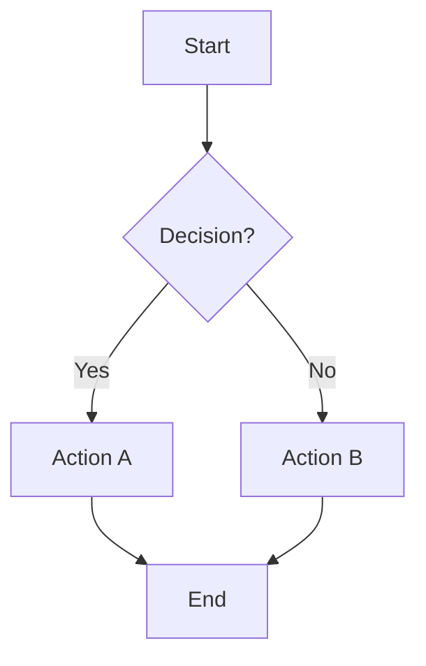
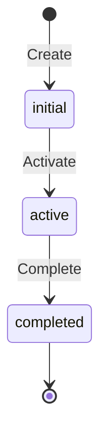
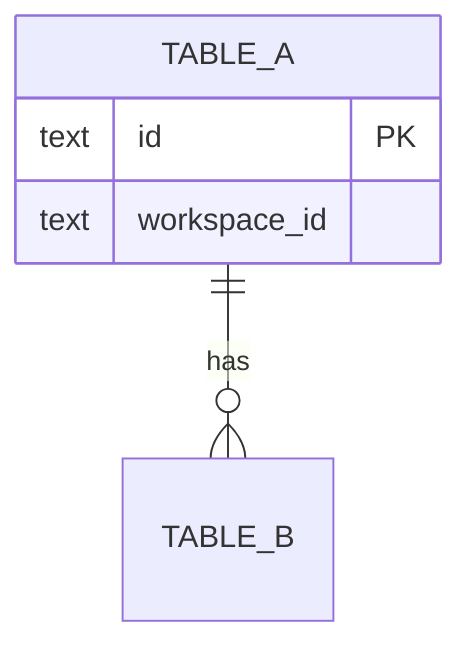

# <!-- Title -->

## Problem & Context

<!-- Answer three questions:
1. What problem are we solving? (1-2 sentences)
2. Why now? (What triggered this work)
3. What constraints exist? (Time, tech debt, dependencies)
-->

## Proposed Solution

<!-- High-level approach in 3-5 bullet points. No implementation details — those go in later sections. Include:
- Which existing services/domains are affected
- New services/packages to create
- Integration approach
-->

## Diagrams

<!-- INSTRUCTIONS: Include at least one Mermaid diagram. Delete diagram subsections below that don't apply.
Add custom sections when they better tell the story (e.g., "Current State" vs "Target State" for fixing broken flows).
See references/rfd-writing-guide.md for examples of each type. -->

<!-- DELETE THIS SUBSECTION if no sequential business process to visualize -->
### Process Flow



<!-- DELETE THIS SUBSECTION if entity has no status field -->
### Entity Lifecycle



<!-- DELETE THIS SUBSECTION if Data Schema has fewer than 2 tables -->
### Data Model



## Architecture Decision

<!-- One or more ADR-style decisions. Repeat block for each decision. DELETE if no significant architectural choices. -->

### Decision: <!-- Short title -->

**Context:** <!-- What forces are at play? -->

**Decision:** <!-- What was decided and why -->

**Consequences:**
- (+) <!-- Positive outcome -->
- (-) <!-- Trade-off accepted -->

## Data Schema

<!-- SQL DDL — directly usable for migrations.
Rules: No FK constraints, always workspace_id, soft deletes with deleted_at, TEXT for IDs, NUMERIC for money, INTEGER for bounded values, BIGINT for unbounded growth, partial indexes with WHERE deleted_at IS NULL.
DELETE this section if no database changes. -->

```sql
-- New tables / ALTER statements here
```

## API Contract

<!-- Go interface definitions — compatible with GenTS pipeline.
Rules: RPC signature (r *http.Request, args *ReqType, reply *ResType) error, *_api package naming, int64 for integers, *string for optional fields.
DELETE this section if no new API endpoints. -->

```go
// Package: {domain}_api

type {Domain}ServiceAuth interface {
    // Define methods here
}

// Request/Response types here
```

## Implementation Boundaries

### Auto-approve
<!-- AI agent can proceed without asking -->
- Generate migration files from schema section
- Create service scaffold
- Generate CRUD SQL queries
- Write integration tests
- Run `yarn gen:ts`

### Ask first
<!-- AI agent should confirm before proceeding -->
- Modify existing service interfaces
- Change indexes on existing tables
- Add cross-domain dependencies

### Never
<!-- AI agent must not do -->
- Drop or alter existing migrations
- Remove API endpoints
- Skip integration tests

## Acceptance Criteria

<!-- Testable completion conditions. Each should be verifiable by running a test or checking a specific behavior. -->
- [ ] <!-- Criterion 1 -->
- [ ] <!-- Criterion 2 -->
- [ ] `make quality-check` passes with 0 issues
- [ ] Integration tests cover each endpoint happy path
- [ ] `yarn gen:ts` produces typed hooks

## Open Questions

<!-- Numbered questions with context. DELETE this section if none. -->

## Alternatives Considered

<!-- What was rejected and why. DELETE this section if none. -->

## Changelog

| Date | Change |
|------|--------|
| <!-- YYYY-MM-DD --> | Initial draft |
