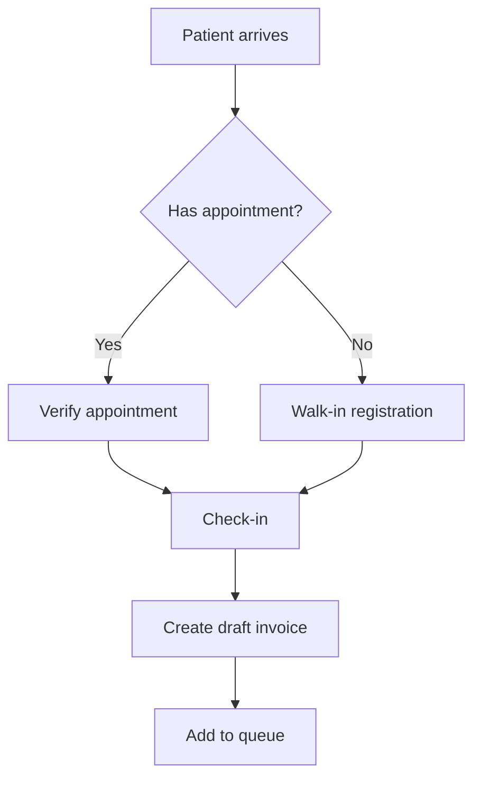
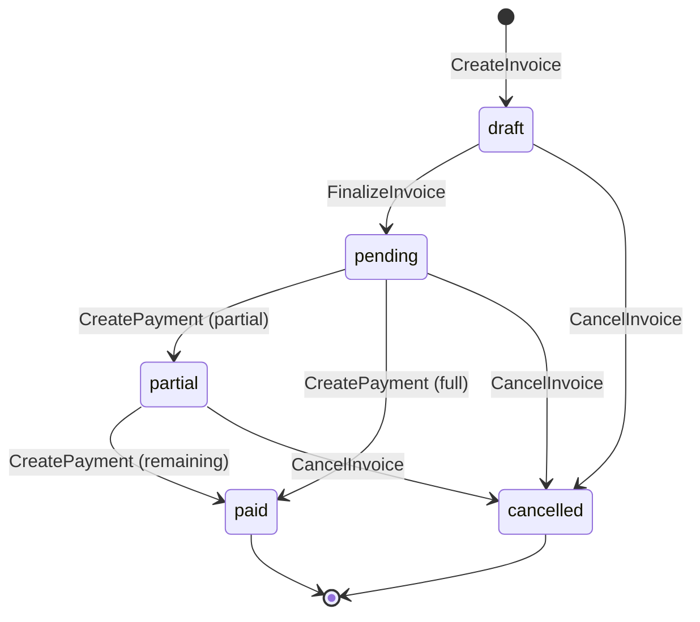
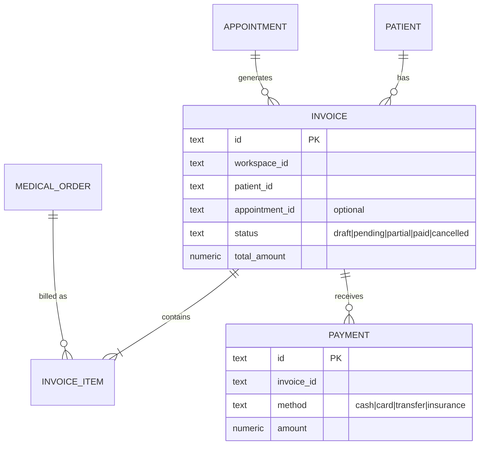
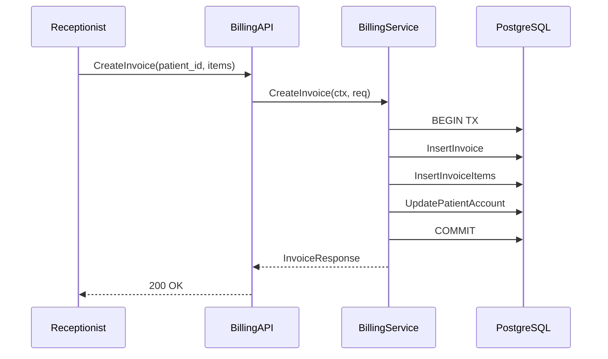
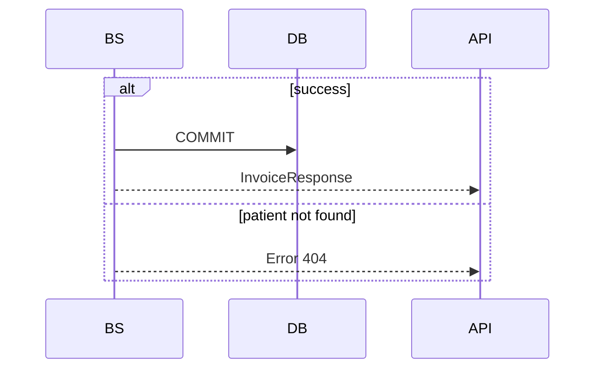
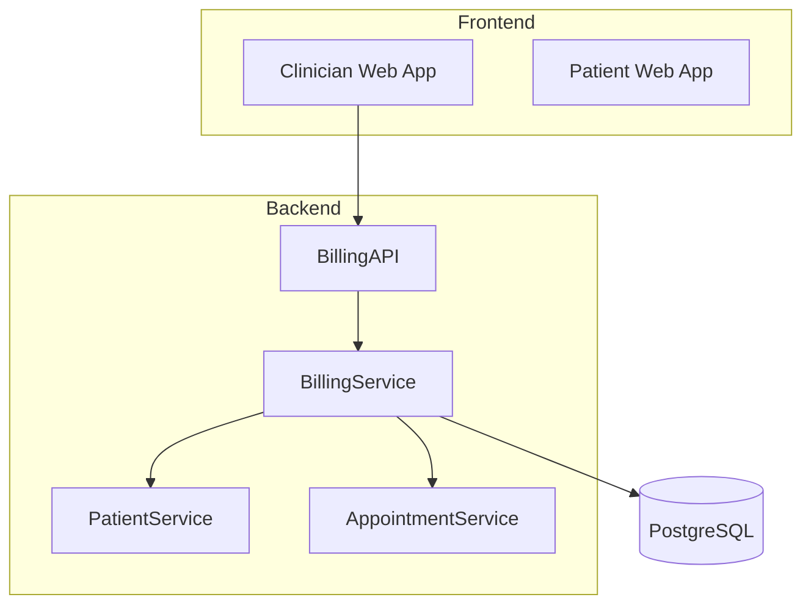

# RFD Writing Guide

Detailed guidance for writing each section of an RFD document. This guide is optimized for producing documents that serve both human reviewers and AI coding agents.

## Core Philosophy

**Timely over polished.** An RFD in `draft` status with rough ideas is more valuable than no document at all. Perfection is the enemy of discussion.

**Machine-readable where possible.** Schemas in SQL DDL, API contracts in Go type definitions, acceptance criteria as testable statements. AI agents parse these directly into implementation.

**Lean but sufficient.** Every section earns its place. If a section doesn't inform an implementation decision, remove it.

**Visual with Mermaid.** Diagrams communicate flow, state, and relationships faster than prose. Every RFD should have at least one Mermaid diagram.

## Section-by-Section Guide

### Metadata Block

```yaml
---
title: Human-readable title
domain: billing  # Check backend/src/interfaces/ for *_api packages. Use name without _api suffix.
status: draft | discussion | accepted | partially-implemented | implemented | abandoned
author: Name or handle
created: YYYY-MM-DD
updated: YYYY-MM-DD
related:
  - domain-seq-slug (link to related RFDs)
---
```

**Tips:**
- `domain` must match project service domains — run `ls backend/src/interfaces/` to discover them
- For cross-domain features, comma-separate: `domain: pharmacy, billing, prescription`
- `related` links RFDs that share context (e.g., billing RFD references booking RFD)
- Update `updated` date on every edit

### Problem & Context

Answer three questions:
1. **What problem are we solving?** (1-2 sentences)
2. **Why now?** (What triggered this work)
3. **What constraints exist?** (Time, tech debt, dependencies)

**Bad example:**
> We need to add billing to the system.

**Good example:**
> Patients complete visits but there's no way to generate invoices or collect payments. The checkout step in the clinical workflow is blocked. Must integrate with existing appointment and medical order data without requiring schema changes to those domains.

### Proposed Solution

High-level approach in 3-5 bullet points. No implementation details — that comes in later sections.

**Include:**
- Which existing services/domains are affected
- New services/packages to create
- Integration approach (loose coupling, event-driven, direct calls)

**Exclude:**
- Code snippets (save for Architecture Decision / API Contract)
- UI mockups (separate document)
- Deployment concerns (unless architectural)

### Diagrams (Mermaid)

Every RFD should include at least one Mermaid diagram. Use the right type for the situation.

#### Flowchart — Business Process / Request Handling

Use for: feature workflows, decision trees, request pipelines.

````markdown

````

**Tips:**
- Use `TD` (top-down) for sequential flows, `LR` (left-right) for pipelines
- Diamond `{}` for decisions, rounded `()` for start/end, square `[]` for actions
- Keep under 15 nodes — split into sub-diagrams if larger

#### State Diagram — Entity Lifecycle

Use for: status transitions (invoice, appointment, queue item).

````markdown

````

**Tips:**
- Label transitions with the API method or event that triggers them
- Include terminal states `[*]`
- Show the happy path prominently, edge cases as secondary paths

#### ER Diagram — Data Model Relationships

Use when: Data Schema section has 2+ related tables. Shows cardinality without FK constraints (matching project convention of service-layer validation).

````markdown

````

**Tips:**
- Use `||--o{` for one-to-many, `||--|{` for one-to-many (required), `||--||` for one-to-one
- Include key columns only (PK, FKs, status, important fields)
- Add comments for enum values and optional fields
- Mirror the tables from Data Schema section

#### Sequence Diagram — Service Interactions

Use when: 3+ services interact in a flow.

````markdown

````

**Tips:**
- Solid arrows `->>`  for requests, dashed `-->>`  for responses
- Show transaction boundaries (`BEGIN TX` / `COMMIT`)
- Include error paths with `alt` blocks for important failure scenarios:

````markdown

````

#### Architecture / Dependency Graph

Use for: high-level system overview, domain dependencies.

````markdown

````

**Tips:**
- Use `subgraph` to group related components
- Cylinder `[()]` for databases, rectangle `[]` for services
- Show data flow direction, not dependency direction

#### Choosing the Right Diagram

| Situation | Diagram Type |
|-----------|-------------|
| "When X happens, then Y, unless Z" | `flowchart` |
| "Entity goes from state A to B via action C" | `stateDiagram-v2` |
| "Table A relates to Table B" | `erDiagram` |
| "Service A calls B which calls C" | `sequenceDiagram` |
| "System is composed of X, Y, Z" | `graph TD` with subgraphs |

#### Diagram Quality Checklist

- [ ] At least one diagram per RFD
- [ ] ER diagram present when 2+ tables in Data Schema
- [ ] Sequence diagram present when 3+ services interact
- [ ] State diagram present when entity has status field
- [ ] Diagrams render correctly in GitHub/VSCode Markdown preview
- [ ] No diagram exceeds ~15-20 nodes (split if larger)

### Architecture Decision

Use ADR (Architecture Decision Record) format inline. Multiple decisions can be listed.

```markdown
#### Decision: {Short title}

**Context:** What forces are at play? What constraints?

**Decision:** What was decided and why.

**Consequences:**
- (+) Positive outcome
- (-) Trade-off accepted
- (~) Neutral/unknown impact
```

**Example:**
```markdown
#### Decision: Loose coupling via optional appointment_id

**Context:** Billing needs appointment context but must also work for walk-ins without appointments.

**Decision:** Add optional `appointment_id` to invoices. Patient ID is the primary anchor.

**Consequences:**
- (+) Works for both appointment-based and walk-in billing
- (+) No changes to appointment schema required
- (-) Must handle null appointment_id in all queries
```

### Data Schema

**Format: SQL DDL** — directly usable for migrations.

```sql
-- New table
CREATE TABLE invoices (
    id              TEXT PRIMARY KEY,
    workspace_id    TEXT NOT NULL,
    patient_id      TEXT NOT NULL,
    appointment_id  TEXT,              -- optional, loose coupling
    status          TEXT NOT NULL DEFAULT 'draft',
    total_amount    NUMERIC(12,2) NOT NULL DEFAULT 0,
    created_at      TIMESTAMPTZ NOT NULL DEFAULT NOW(),
    updated_at      TIMESTAMPTZ NOT NULL DEFAULT NOW(),
    deleted_at      TIMESTAMPTZ
);

-- Indexes
CREATE INDEX idx_invoices_patient ON invoices(workspace_id, patient_id) WHERE deleted_at IS NULL;
CREATE INDEX idx_invoices_status ON invoices(workspace_id, status) WHERE deleted_at IS NULL;
```

**Rules for this project:**
- No FK constraints (service-layer validation instead)
- Always include `workspace_id` for multi-tenancy
- Soft deletes with `deleted_at` column
- Use `TEXT` for IDs (objectid format)
- Use `NUMERIC(12,2)` for money, not float
- Use `INTEGER` for bounded values, `BIGINT` for unbounded growth
- Partial indexes with `WHERE deleted_at IS NULL`

### API Contract

**Format: Go interface definitions** — compatible with the GenTS pipeline (`yarn gen:ts`).

Follow the project's GenTS-compatible RPC pattern:

```go
// Package: billing_api
type BillingServiceAuth interface {
    CreateInvoice(r *http.Request, args *CreateInvoiceRequest, reply *CreateInvoiceResponse) error
    GetInvoice(r *http.Request, args *GetInvoiceRequest, reply *GetInvoiceResponse) error
    ListInvoices(r *http.Request, args *ListInvoicesRequest, reply *ListInvoicesResponse) error
}

type CreateInvoiceRequest struct {
    PatientID     string   `json:"patient_id"`
    AppointmentID *string  `json:"appointment_id,omitempty"`
    Items         []Item   `json:"items"`
}

type CreateInvoiceResponse struct {
    ID     string `json:"id"`
    Status string `json:"status"`
}
```

**Rules for this project:**
- Method signature: `(r *http.Request, args *ReqType, reply *ResType) error`
- `Get*/List*/Find*/Search*` → generates `useQuery` hooks
- All others → generates `useMutation` hooks
- Use `*string` for optional fields, not `pgtype.Text`
- Use `int64` for all integer fields in API types
- Package name: `{domain}_api` suffix to avoid collisions

### Implementation Boundaries

Define what AI agents can do autonomously vs. what needs human review.

```markdown
#### Auto-approve (AI agent can proceed without asking)
- Generate migration files from schema section
- Create service scaffold following service-creation skill
- Generate CRUD SQL queries
- Write integration tests for defined endpoints
- Run `yarn gen:ts` after API changes

#### Ask first (AI agent should confirm before proceeding)
- Modify existing service interfaces
- Change database indexes on existing tables
- Add cross-domain dependencies
- Alter enum values used by other domains

#### Never (AI agent must not do)
- Drop or alter existing migration files
- Remove API endpoints (breaking change)
- Change ID generation strategy
- Skip integration tests
```

### Acceptance Criteria

Write as testable statements. Each criterion should be verifiable by running a test or checking a specific behavior.

**Bad:**
> The billing system should work correctly.

**Good:**
```markdown
- [ ] `CreateInvoice` returns invoice with status `draft` and generated ID
- [ ] `CreateInvoice` with invalid patient_id returns error
- [ ] `FinalizeInvoice` transitions status from `draft` to `pending`
- [ ] `CreatePayment` for full amount transitions invoice to `paid`
- [ ] `CreatePayment` for partial amount transitions invoice to `partial`
- [ ] Integration test covers each endpoint happy path
- [ ] `yarn gen:ts` produces typed hooks for all endpoints
- [ ] `make quality-check` passes with 0 issues
```

### Open Questions

List unresolved items that need team discussion. Format as numbered questions with context.

```markdown
1. **Currency handling**: Should we support multi-currency now or default to VND only?
   - Leaning toward VND-only for MVP, add currency field later
2. **Tax calculation**: Is tax included in item prices or calculated separately?
   - Need input from business team
```

### Alternatives Considered

For each significant decision, document what was rejected:

```markdown
#### Tight coupling via appointment_id FK
- **Rejected because**: Would require appointment for all billing, breaks walk-in flow
- **Would have provided**: Automatic cascade deletes, referential integrity at DB level

#### Separate billing microservice
- **Rejected because**: Premature for current scale, adds deployment complexity
- **Would have provided**: Independent scaling, separate deployment cycle
```

### Changelog

Track evolution at the bottom:

```markdown
## Changelog

| Date | Change |
|------|--------|
| 2026-01-05 | Initial draft |
| 2026-01-07 | Added payment schema after team discussion |
| 2026-01-10 | Status → accepted, resolved open questions #1 and #2 |
```

## Patterns from Real RFDs

These patterns emerged from actual RFDs in this project and work well:

### Before/After Diagrams

When fixing a broken flow, show the current state and target state side by side. This makes the problem visceral and the solution clear. Example from `pharmacy-001`:

```markdown
### Current State (Broken)
<!-- flowchart showing what fails today -->

### Target State
<!-- flowchart showing the fix -->
```

This is more effective than a single diagram because reviewers can see exactly what changes.

### Status Transition Tables

Complement state diagrams with a transition table. The diagram shows the flow visually; the table captures side effects that diagrams can't easily show:

```markdown
| From | To | Trigger | Side Effects |
|------|----|---------|-------------|
| draft | pending | `FinalizeInvoice()` | Coverage computed, payer allocations created |
```

### Multi-Domain RFDs

When a feature spans domains (e.g., pharmacy + billing + prescription), use the primary domain for the filename but list all in metadata. Structure the RFD around the integration points rather than repeating each domain's internal details.

### Adapting the Template

Not every section applies to every RFD. Remove sections that add no value:
- **No new tables?** Delete Data Schema
- **No new endpoints?** Delete API Contract
- **Pure backend?** No need for frontend acceptance criteria
- **Single service?** Skip sequence diagrams

The template is a menu, not a mandatory checklist.

## Anti-Patterns

### Over-specification
Including implementation details that belong in code, not docs. If it's a single function's logic, it doesn't need an RFD section.

### Under-specification of schemas
Vague descriptions like "we need a table for invoices" without DDL. AI agents can't generate migrations from prose.

### Missing boundaries
Without implementation boundaries, AI agents either do too much (breaking things) or too little (constant confirmation requests).

### Stale RFDs
An RFD in `accepted` status that was implemented months ago but never updated to `implemented`. Keep lifecycle current.

### Leaving all placeholder diagrams
The template includes flowchart, state, and ER placeholders. Delete the ones that don't apply — placeholder diagrams with generic content are worse than no diagram because they suggest the author didn't think about the design.
